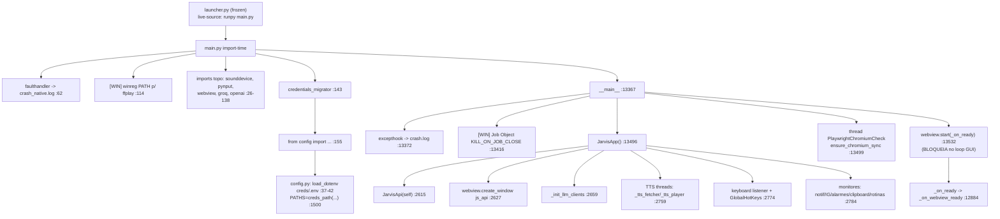
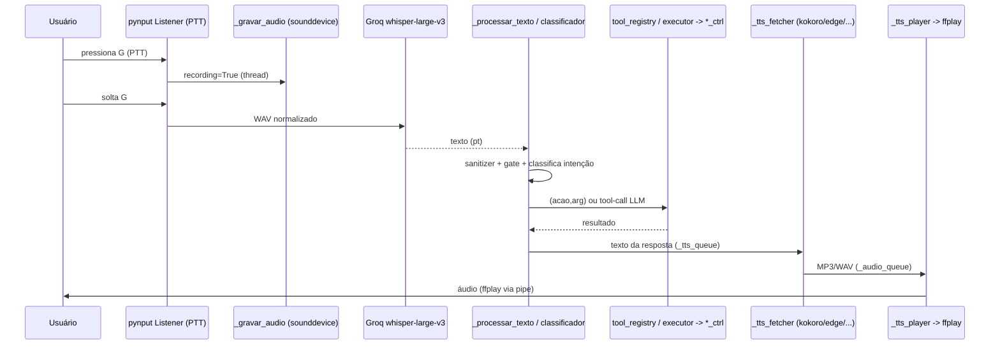

# Mapa de execução do J.A.R.V.I.S (para o port Linux)

**Data:** 2026-09-13 · **Somente leitura** (nenhum `.py` alterado). Complementa `../../REVISAO_2026-09.md`.

**Decisão do dono (já registrada):** alvo Linux em **Fedora/Nobara (dnf)**, **Arch (pacman)** e **Debian/Ubuntu (apt)**, em **Wayland e X11**; distribuição por **AppImage bem-acabado** (ícone, `.desktop`, integração de menu). Isso **substitui** a recomendação de Flatpak/rpm do relatório anterior.

Máquina do dono: Nobara/Fedora 44, KDE Plasma 6, Wayland.

---

## 1. Boot — sequência exata

### 1.1 `launcher.py` (entrypoint do `.exe`)
Só é usado no binário congelado (PyInstaller). Truque **live-source**: se `sys.frozen` e existir `main.py` dois níveis acima do exe (ou em `JARVIS_SOURCE`), insere esse caminho em `sys.path[0]` e faz `runpy.run_path(".../main.py")`; senão `runpy.run_module("main")`. O bloco `if False:` (linhas ~35-58) existe só para o scanner estático do PyInstaller enxergar `main` + o pacote `jarvis/`. **Em dev roda-se `python main.py` direto** — o launcher é ignorado.

### 1.2 `main.py` — nível de módulo (import time), em ordem
| Ordem | main.py | O que faz |
|---|---|---|
| 1 | `_res()` :36 / `_data()` :45 | Resolvem caminhos de assets e de dados. `_data()` = base de dados de runtime (hoje `%APPDATA%/…` no Windows). |
| 2 | :62 | `_fault_path = _data("crash_native.log")` → **`faulthandler`** aponta para este arquivo (é a origem do log de 514 MB). |
| 3 | :73-96 | `_StderrTee` → duplica stderr para `_data("stderr.log")`. `atexit` grava `exit.log`. |
| 4 | :114 | **[WIN]** `if sys.platform == "win32":` lê `PATH` do **registro** (`winreg`) para achar `ffplay` (winget). Única trava de plataforma no import. |
| 5 | :131-138 | Imports de **topo**: `numpy`, `sounddevice`, `edge_tts`, `openai`, `groq`, `duckduckgo_search`, **`pynput`** (`keyboard`, `GlobalHotKeys`). |
| 6 | :143 | `core.credentials_migrator.migrate_to_credentials_dir()` roda **ANTES** de importar `config`, para o `.env` já estar em `credentials/`. |
| 7 | :155 | `from config import (...)` → **carrega `config.py`** (ver 1.3). Traz `GROQ_API_KEY`, `SPOTIFY_CLIENT_ID/SECRET`, `PATHS`, etc. |
| 8 | :26 | `import webview` (topo) — pywebview. |

### 1.3 `config.py` (carregado no passo 7)
| config.py | O que faz |
|---|---|
| :7 | `from dotenv import load_dotenv`. |
| :18 | `creds_path(*parts)` → resolve dentro de `credentials/`. |
| :37-42 | `_env_creds = creds_path(".env")`; se existir, `load_dotenv(_env_creds, override=False)`, senão o `.env` legado. **Segredos só via `os.environ`** (nunca hardcoded). |
| :786 | usa `LOCALAPPDATA` (path de cache). |
| :1455-1456 | `GMAIL_CREDENTIALS_FILE`/`GMAIL_TOKEN_FILE` = `creds_path(...)`. |
| :1500 | `PATHS = {...}` — todos via `creds_path(...)` (contatos, alarmes, prefs, modo, …). |

> **Credenciais (SEM valores):** lidas de `credentials/.env` para `os.environ`; nunca versionadas (só templates). Ver memória de segurança do projeto.

### 1.4 `if __name__ == "__main__":` (main.py :13367-13535)
1. **:13372-13410** — instala `sys.excepthook` + `threading.excepthook` → gravam em `crash.log`.
2. **:13416-13493 [WIN]** — cria **Job Object** (`CreateJobObjectW` + `KILL_ON_JOB_CLOSE | BREAKAWAY_OK`, `AssignProcessToJobObject`). Handle guardado global (`_JARVIS_JOB_HANDLE`). Garante que filhos (WebView2, `msedgewebview2.exe`, Chromium do Playwright) morram junto com o processo.
3. **:13496** — `app = JarvisApp()` (ver 1.5).
4. **:13499-13510** — thread daemon `PlaywrightChromiumCheck` → `jarvis.browser.playwright_setup.ensure_chromium_sync()`.
5. **:13512-13525** — define `_on_ready` (sleep 0.8 → `app._on_webview_ready()`); prepara `%APPDATA%/JARVIS/webview_data` para o WebView2.
6. **:13532** — `webview.start(_on_ready, debug=…, storage_path=_wv_data)` — **bloqueia** no loop GUI até fechar.

### 1.5 `JarvisApp.__init__` (main.py :2613-2826) — ordem
1. `self._api = JarvisApi(self)` :2615 (ponte JS↔Python).
2. Lê tema salvo (:2617) → `webview.create_window(..., js_api=self._api)` :2627 (título "…v7.3", 1380×870, storage em `%APPDATA%/JARVIS/webview_data`).
3. Proxies de UI (`_RootProxy`, `_EntryProxy`, `_LabelProxy`) :2634-2640 — **`root.after(0, …)` marshala chamadas para a thread do webview** (equivalente ao mainloop do Tk).
4. Bridge LLM modular opt-in (`jarvis.llm.bridge`) :2646-2653 (só se `config.LLM_USE_MODULAR_CLIENT`).
5. `_init_llm_clients()` :2659 (Groq / LM Studio / OpenRouter).
6. Recarrega histórico (`comandos.memoria_jarvis.carregar`) :2664.
7. Estado (dezenas de campos) :2687-2755. `_conectar_spotify` em thread se houver credenciais :2686.
8. `_load_prefs()` :2732 → `core.config_manager.get_config_manager()` :2737 (aplica overrides a `config`).
9. **Filas e threads de TTS** :2757-2764 — `_tts_fetch_thread`→`_tts_fetcher`, `_tts_play_thread`→`_tts_player` (daemons).
10. `_gerar_som_ativacao()` :2766; `self._ffplay = shutil.which("ffplay")` :2770.
11. `_start_keyboard_listener()` :2774 (pynput `Listener`), `_start_global_hotkeys()` :2775 (pynput `GlobalHotKeys`), `_start_config_watcher()` :2776 (só dev).
12. Threads de monitor :2784-2791 — `_iniciar_monitor_notif`, `_iniciar_monitor_instagram`, `_purgar_historico_notif`, `_verificar_alarmes_startup`.
13. Monitores externos :2793-2823 — `clipboard_hist_ctrl.start_monitor()`, `rotinas_ctrl.start_monitor(...)`, `condicional_ctrl.start_monitor(...)`.
14. `>>> [JARVIS] Inicialização concluída` :2826.

### 1.6 Diagrama de boot (Mermaid)

---

## 2. Concorrência — threads, processos, asyncio, timers

**Modelo:** ~**83 `threading.Thread`**, quase todas `daemon=True` (morrem com o processo). Não há `multiprocessing` nem `ThreadPoolExecutor`. Marshaling para a UI via `root.after(0, fn)` (proxy do webview). O `asyncio` fica isolado no `BrowserPool` (`jarvis/browser/pool.py`, `run_sync`).

### 2.1 Threads de longa duração (criadas no boot)
| Thread (nome/target) | main.py | Papel | Encerramento |
|---|---|---|---|
| `_tts_fetcher` | :2759 | consome `_tts_queue`, gera áudio (TTS) → `_audio_queue` | daemon; sentinela `None` |
| `_tts_player` | :2762 | consome `_audio_queue`, toca via **ffplay** (subprocess) | daemon; sentinela `None` |
| `keyboard.Listener` | :11601 | PTT (`_on_key_press`/`_on_key_release`) — **pynput** | `_listener.stop()` |
| `GlobalHotKeys` | :11640 | atalhos globais de `config.HOTKEYS` — **pynput** | `.stop()` ao re-registrar |
| `ConfigWatcher` | :11680 | mtime de `config.py` (só dev) | daemon, loop `while True` |
| `_iniciar_monitor_notif` | :2784 | **[WIN]** toasts WhatsApp/Discord (WinRT/UIAutomation) | daemon |
| `_iniciar_monitor_instagram` | :2787 | polling instagrapi | daemon |
| `_purgar_historico_notif` | :2789 | limpeza periódica | daemon |
| `PlaywrightChromiumCheck` | :13506 | garante Chromium do Playwright | daemon, one-shot |
| `JarvisDashboard` | dashboard/server.py :380 | uvicorn FastAPI `:8765` | daemon |
| `AutoUpdater` | :13206 | checa/aplica update e reinicia | daemon, one-shot |
| tray (`pystray`) | :13292 | **[WIN]** ícone de bandeja | thread do pystray |

### 2.2 Threads sob demanda (exemplos)
`_conectar_spotify` :2686; `_ativar/_desativar_game_mode` :6106-6109; `_ativar/_desativar_dev_mode` :6117-6120; `_ativar/_desativar_gesture` :6134-6137; `_ativar/_desativar_eye_control` :6144-6147; `_calibrar_olhos` :6150; `_gravar_audio` :11809/11821; `_processar_audio` :11854; `_chamar_chat` :9103; workers de notícias/YT/carteira/imagem/IDE :8205-8539; `Restart` :6458.

### 2.3 asyncio / timers / subprocessos
- **asyncio:** `BrowserPool` usa `async_playwright()` num loop próprio; `run_sync(coro)` para chamadas síncronas. `asyncio.new_event_loop`/`run_until_complete` (1 uso cada em main.py).
- **`threading.Timer`:** 5 usos pontuais.
- **`subprocess.Popen` (5):** `_tts_process` (tipo) :2691; `notepad.exe` fallback :2895 **[WIN]**; **restart** `sys.executable` :6434/6447 (portável); **ffplay** :12723 (com `CREATE_NO_WINDOW` — ver §4).
- **Job Object (Windows):** o mecanismo de "matar filhos ao sair". No Linux não existe → usar **grupo de processo** (`start_new_session`/`os.setsid`) + `prctl(PR_SET_PDEATHSIG)` nos filhos, ou um cgroup; matar o grupo no `atexit`.

---

## 3. Fluxos ponta a ponta

### 3.1 (a) Voz: PTT/wake → STT → intenção → tool → TTS
Cadeia de chamadas (main.py):
1. **Ativação:** `_on_key_press` :11791 (PTT, tecla G/Shift via `_is_g_key` :245) → `recording=True` → thread `_gravar_audio` :11809. Alternativa: `_wake_word_loop` :11255 (wake word) ou `GlobalHotKeys` :11640 → `_processar_texto(cmd,"hotkey")`.
2. **Captura:** `_gravar_audio` :11858 — `sd.InputStream(device, MIC_RATE, int16)` acumula frames enquanto `recording`.
3. **Release:** `_on_key_release` :11823 → thread `_processar_audio` :11854.
4. **STT:** `_processar_audio` :11901 → `_normalizar_audio` → `_frames_para_wav` → **Groq `whisper-large-v3`** `audio.transcriptions.create(..., language="pt")` :11919 (nuvem).
5. **Roteamento:** `_processar_texto(texto,"voz")` :9078 → sanitizer/security gate (:9090) → confirmação de alto risco (:9110) → classificação (regex + `_classificar_voice_rapido` :2919, ou tool-calling do LLM).
6. **Dispatch:** `_executar_comando_sistema` :5546 → `comandos/tool_registry.py`/`executor.py` → controller `*_ctrl.py`.
7. **Resposta → fala:** `_exibir_resposta` → `_falar`/`_falar_streaming` :12511/12527 → `_tts_queue` → `_tts_fetcher` :12561 (kokoro/edge/elevenlabs/gemini) → `_audio_queue` → `_tts_player` :12709 → `subprocess.Popen([ffplay, -nodisp -autoexit -f mp3 -i pipe:0])` :12723, alimentando MP3 pela stdin.

### 3.2 (b) Ponte JS↔Python (pywebview) e a corrida do `reload_ui`
- **JS→Python:** métodos de `JarvisApi` (main.py :1486-2534) expostos via `js_api`: `send_message` :1512, `toggle_mic` :1941, `apply_models` :1670, `open_url` :1887, `apply_update_now` :1902, `reload_ui` :2500, etc. Chamados do frontend por `window.pywebview.api.<m>()` (`ui/core/jarvis-bridge.js`).
- **Python→JS:** `self._window.evaluate_js("addMessage(...)")` via `_append` :2832, `_set_status` :2855, etc. — sempre dentro de `root.after(0, …)` para rodar na thread do webview.
- **Corrida do `reload_ui`:** `jarvis-bridge.js:201` chama `pyApi('reload_ui')` (F5/Ctrl+R). `reload_ui` :2500 chama `_reload_with_theme` → `load_html`/`load_url`, que **destrói o contexto JS** que ainda aguarda o retorno da chamada. Quando o pywebview tenta resolver o callback, o registro sumiu → `window.pywebview._returnValuesCallbacks.reload_ui.<id> is not a function` (ver `crash.log`). **Correção sugerida (fora do escopo, só leitura):** agendar o reload após retornar (ex.: `root.after(0, ...)`), ou não aguardar retorno para `reload_ui`.

### 3.3 (c) Mensageria via BrowserPool/Playwright
- `jarvis/browser/pool.py` — `BrowserPool` singleton, `OrderedDict[(profile,platform)]`, `launch_persistent_context(user_data_dir=...)` (preserva login QR/cookies). `async_playwright()` lazy :50.
- Backends web em `jarvis/messaging/backends/*` (WhatsApp/Discord/IG/Telegram/Gmail — "Chromium-only") sobre `web_base.WebChatBackend`; router em `jarvis/messaging/router.py`.
- Legado: `comandos/msg_sender.py` (envio via Chromium humano + `pyautogui`/`os.startfile`), `comandos/browser_ctrl.py` (detecção de navegador via **winreg**).
- Chromium do Playwright: `jarvis/browser/playwright_setup.py` — `PLAYWRIGHT_BROWSERS_PATH` (frozen: `.local-browsers` em `_internal`; dev: `%LOCALAPPDATA%/ms-playwright`, e **`~/.cache/ms-playwright` no Linux**), `ensure_chromium_sync` :111 (auto-`playwright install chromium`).

### 3.4 (d) Gestos (MediaPipe) e overlay
- `_ativar_gesture` :6943 → `gesture_interface.main.GestureSystem` :6959. `GestureSystem` orquestra `HandTracker` (webcam local, **MediaPipe** — nenhum frame sai do processo), `EyeTracker`, `DesktopController` (**pyautogui**), `Canvas2DEngine`/`Workspace3DEngine` (overlays), `LiveView` (**tkinter**), `GestureUI` (**pywebview**).
- **Imports de topo problemáticos:** `gesture_interface/main.py:25 import pyautogui`; `gesture_interface/desktop_control/controller.py:19 import pyautogui`; `gesture_interface/ui/app.py:11 import webview`. `pyautogui` no topo → falha/degrada na importação sob Wayland.

### 3.5 (e) Dashboard / IDE (FastAPI)
- `dashboard/server.py` — `_run_server` :352 usa `uvicorn.Config` :354; `start_dashboard` :366 sobe thread daemon `JarvisDashboard` :380 em `:8765` (+ WebSocket). Sem auth/TLS (uso local).
- `ide/` — FastAPI (`/ide`), terminal multi-sessão (`ide/terminal.py`), workspace isolado; fachada `comandos/ide_ctrl.py` (que também dispara `start_dashboard`).

### 3.6 (f) Auto-update
- `JarvisApi.apply_update_now` :1902 e thread `AutoUpdater` :13206 → `updater/check_update.py`: compara `VERSION` com `releases/latest` de `SodreDev/jarvis-releases`, baixa `update_payload` (ou instalador), extrai com validação anti-traversal **preservando** `credentials/`, `data/`, `.venv/`, `.git/`, aplica e **reinicia** (`_restart` → `subprocess.Popen([sys.executable])`). **No AppImage isso muda** para AppImageUpdate/zsync (ver §6).

---

## 4. Pontos de contato com o SO (Windows) — arquivo:linha

Legenda: **T** = import de topo (quebra já na importação) · **L** = lazy (dentro de função) · **RT** = quebra em runtime.

| Contato Windows | Onde (arquivo:linha) | T/L | Fluxo que quebra no Linux | Alvo Linux |
|---|---|---|---|---|
| `import webview` (WebView2) | main.py:26 (T); gesture ui/app.py:11 | T | UI principal | pywebview backend **Qt WebEngine** (PyQt6/PySide6) |
| `from pynput import keyboard, GlobalHotKeys` | main.py:137-138 | T | PTT + hotkeys globais | X11: pynput; **Wayland:** portal GlobalShortcuts / KGlobalAccel + ydotool |
| `import pyautogui` | gesture main.py:25; desktop_control/controller.py:19 | T | Gestos → mouse/teclado | ydotool/wtype (Wayland) |
| `winreg` (PATH ffplay) | main.py:114 | L | boot (ffplay) | `ffmpeg` no PATH; remover hack |
| **Job Object** (`CreateJobObjectW`…) | main.py:13416-13493 | L | matar filhos ao sair | grupo de processo/`setsid` + `PR_SET_PDEATHSIG` |
| `subprocess … CREATE_NO_WINDOW` | main.py:12726 | RT | **TTS (ffplay) — `AttributeError` no Linux** | remover flag; já há `getattr(subprocess,"CREATE_NO_WINDOW",0)` em games_ctrl:34, modelo_local:110, game_platform_detector:592 |
| `notepad.exe` (fallback texto) | main.py:2895 | L | viewer de texto | usar viewer HTML (já é o default) / `xdg-open` |
| `os.startfile(...)` | msg_sender:432/526/578/709; janela_ctrl:248/260/636; executor:27; games_ctrl:27; tool_registry:1761/2089/2199/2355/2389 | L | abrir arquivos/apps/URIs | `xdg-open`/`gio open` |
| `pycaw` (volume/mic) | system_ctrl:89-156 | L | volume do sistema/mic | PipeWire: `wpctl`/`pactl`/`pulsectl` |
| `win32gui`/`user32` (janela em foco) | condicional_ctrl:66-81 | L | regras condicionais por janela | KWin D-Bus / `kdotool` |
| `pygetwindow` (janelas) | janela_ctrl:34/879 | L | mover/focar janelas | `kdotool` / KWin scripting |
| `winreg` (navegador/apps) | browser_ctrl:107-195; game_platform_detector | L | detecção de navegador/jogos | `xdg-settings`/`xdg-mime`/`.desktop`; Steam/Lutris/Heroic paths |
| `powershell` (mídia/system) | midia_ctrl:92; system_ctrl:630/649 | L | media/energia | MPRIS (`playerctl`), `systemctl`/`loginctl` |
| `.exe` fixos (calc/winword/…) | executor:563-594; midia_ctrl:134-142 | L | abrir apps | mapa de apps Linux / `.desktop` |
| WinRT/`winsdk` (ler notificações) | core/winrt_notification_listener.py; notif_ctrl | L | monitor de notificações | monitorar D-Bus `org.freedesktop.Notifications` |
| `pystray` (bandeja) | main.py:13252/13292 | L | tray | StatusNotifierItem (libayatana-appindicator) |
| mss/`ImageGrab`/`pyautogui.screenshot` | ocr_ctrl:29-46; janela_ctrl:935-939; discord_ctrl:684-695; main.py:6558-7065 | L | captura/OCR | X11: mss; **Wayland:** portal ScreenCast/Screenshot, `spectacle`/`grim` |
| Paths `%APPDATA%`/`%LOCALAPPDATA%` | main.py:13519/2623; config.py:786; `_data()` | L | dados/estado | **XDG Base Dirs** (`~/.config`, `~/.local/share`, `~/.cache`) |

**Portável hoje (sem trabalho):** STT (Groq/silero), TTS (kokoro/edge/elevenlabs/gemini), `sounddevice`/PortAudio, LLM clients, Playwright/Chromium, MediaPipe+cv2 (V4L2), FastAPI (dashboard/IDE), documentos, embeddings, `subprocess.Popen([sys.executable])` (restart).

---

## 5. Dependências nativas por distro

Regra aplicada: **libs de aplicação** (Qt, PortAudio, tesseract, OpenCV, MediaPipe, libs do Chromium que não são de GPU) → **DENTRO do AppImage**; **serviços/daemons/kernel/GPU** (PipeWire, portais, ydotoold, FUSE, xdg-utils, `libGL`/`libgbm`/`libdrm`) → **SISTEMA**.

| Componente | Papel | dnf (Fedora) | pacman (Arch) | apt (Debian/Ubuntu) | AppImage vs SISTEMA | Obs |
|---|---|---|---|---|---|---|
| PortAudio | áudio (`sounddevice`) | `portaudio` | `portaudio` | `libportaudio2` | **DENTRO** | `dlopen` de `libportaudio.so.2`; áudio real via PipeWire do sistema |
| Qt6 WebEngine + binding | UI + Chromium embutido | `qt6-qtwebengine` + `python3-pyqt6(-webengine)` ou `python3-pyside6` | `qt6-webengine` + `python-pyqt6(-webengine)` ou `python-pyside6` | `libqt6webenginecore6` + `python3-pyqt6.qtwebengine` ou `python3-pyside6` | **DENTRO** | **pip:** `PySide6` (wheel único, mais autocontido) ou `PyQt6`+`PyQt6-WebEngine`. Exige NSS/fontconfig/libX*/mesa do sistema em runtime |
| Runtime Chromium (Playwright) | `.so` que o Chromium baixado precisa | ver sub-tabela | ver sub-tabela | ver sub-tabela | **MISTO** | `playwright install-deps` só cobre Debian/Ubuntu; Fedora/Arch = manual |
| MediaPipe | visão/ML | wheel pip + `mesa-libGL`,`glib2` | wheel pip + `mesa`,`glib2` | wheel pip + `libgl1`,`libglib2.0-0` | **DENTRO** (wheel) | precisa OpenGL/GLES do sistema |
| OpenCV (`cv2`) | visão | `python3-opencv` | `python-opencv` | `python3-opencv` | **DENTRO** (wheel) | preferir `opencv-python-headless` (evita GL) |
| ffmpeg/ffplay | transcode/playback | `ffmpeg` (RPM Fusion; base = `ffmpeg-free`) | `ffmpeg` | `ffmpeg` | **DENTRO** (build estático) | `ffplay` precisa SDL2; Nobara já traz ffmpeg completo |
| Tesseract + idiomas | OCR (`por`/`eng`) | `tesseract` + `tesseract-langpack-por/eng` | `tesseract` + `tesseract-data-por/eng` | `tesseract-ocr` + `tesseract-ocr-por/eng` | **DENTRO** | empacotar `tessdata/` e apontar `TESSDATA_PREFIX` |
| libnotify/notify-send | notificações | `libnotify` | `libnotify` | `libnotify4` + `libnotify-bin` | **MISTO** | daemon de notificação é do sistema (Plasma) |
| wl-clipboard | clipboard Wayland | `wl-clipboard` | `wl-clipboard` | `wl-clipboard` | **SISTEMA** (fallback) | preferir clipboard nativo do Qt |
| xclip/xsel | clipboard X11 | `xclip`,`xsel` | `xclip`,`xsel` | `xclip`,`xsel` | **SISTEMA** (fallback) | — |
| ydotool(+ydotoold)/wtype | injeção de input (Wayland) | `ydotool`,`wtype` | `ydotool`,`wtype` | `ydotool`,`wtype` | **SISTEMA/serviço** | exige `/dev/uinput` + daemon `ydotoold`; não autocontido |
| PipeWire/WirePlumber + wpctl/pactl | áudio | `pipewire`,`wireplumber`,`pipewire-pulseaudio`,`pulseaudio-utils` | `pipewire`,`wireplumber`,`pipewire-pulse`,`libpulse` | `pipewire`,`wireplumber`,`pipewire-pulse`,`pulseaudio-utils` | **SISTEMA** | nunca empacotar |
| xdg-desktop-portal(+kde) | portais (screenshot, shortcuts) | `xdg-desktop-portal`,`xdg-desktop-portal-kde` | idem | idem | **SISTEMA** | no Plasma usar backend **-kde** |
| kdotool | janelas KDE/Wayland | `kdotool` (oficial Fedora) | AUR `kdotool` | `cargo install kdotool` | **SISTEMA** | usa KWin scripting via D-Bus |
| playerctl | media keys (MPRIS) | `playerctl` | `playerctl` | `playerctl` | **SISTEMA** | — |
| FUSE (libfuse2) | montar AppImage | `fuse-libs` | `fuse2` | `libfuse2` (Ubuntu 24.04: `libfuse2t64`) | **SISTEMA** | ver §6 (runtime estático evita depender disto) |
| xdg-utils | `xdg-open` | `xdg-utils` | `xdg-utils` | `xdg-utils` | **SISTEMA** | — |

**Sub-tabela — libs do Chromium do Playwright (`.so` → pacote):** `nss`/`nss`/`libnss3`; `nspr`/`nspr`/`libnspr4`; `atk`/`atk`/`libatk1.0-0`(t64); `at-spi2-atk`+`at-spi2-core`/`at-spi2-core`/`libatk-bridge2.0-0`(t64); `cups-libs`/`libcups`/`libcups2`(t64); `libxkbcommon`; `libXcomposite`/`libXdamage`/`libXrandr`; `alsa-lib`/`alsa-lib`/`libasound2`(t64); `pango`+`cairo`. **GPU (SISTEMA, nunca empacotar):** `mesa-libgbm`/`mesa`/`libgbm1`, `libdrm`, `mesa-libEGL/GL`/`mesa`+`libglvnd`/`libegl1`+`libgl1`. Validar `.so` faltantes com `ldd` no Chromium baixado.

**Notas:** Nobara 44 já traz RPM Fusion + ffmpeg completo. Ubuntu 24.04 renomeou pacotes (transição **t64**: `libasound2t64`, `libcups2t64`, `libfuse2t64`, etc.). No Arch, `libgbm.so.1` vem no pacote `mesa` (sem pacote avulso).

---

## 6. AppImage — implicações e build

### 6.1 Ferramenta de build (comparação e recomendação)
| Ferramenta | Prós | Contras (neste caso) |
|---|---|---|
| **python-appimage** | interpretador manylinux (glibc antiga garantida); simples p/ app pip | não faz deploy de Qt nem libs C externas (ffmpeg/tesseract/portaudio) |
| **appimage-builder** | resolve deps puxando .deb/.rpm; exemplo PyQt | receitas frágeis; manutenção intermitente; atrito com binário do PyInstaller |
| **linuxdeploy + plugin-qt** | melhor p/ Qt **de sistema** | não entende imports Python; com PyQt6/PySide6 o Qt já vem no wheel → plugin-qt ajuda menos |
| **PyInstaller + appimagetool** ✅ | **hooks maduros** p/ numpy/opencv/mediapipe/torch/PyQt6/QtWebEngine (coleta `QtWebEngineProcess`, `.pak`, `icudtl.dat`); appimagetool só embrulha + injeta update info | ffmpeg/tesseract/portaudio entram à mão; conferir recursos do WebEngine |

**Recomendado: PyInstaller + appimagetool**, buildado em container **manylinux_2_28 (glibc 2.28)**. Com PyQt6/PySide6 o problema dominante é **coletar wheels nativas grandes** (o forte do PyInstaller), não deploy de Qt de sistema. `linuxdeploy` como passada final opcional para varrer `.so`; `python-appimage` como plano B do interpretador.

### 6.2 glibc / baseline
glibc é compatível só **para frente** → buildar na distro **mais antiga** suportada. **Baseline recomendada: glibc 2.28 (manylinux_2_28 ≈ Debian 11/Ubuntu 20.04)**, porque mediapipe/torch/opencv recentes cada vez menos publicam wheels manylinux2014 (2.17). 2.28 cobre Fedora/Nobara, Arch (rolling) e Debian 11+/Ubuntu 20.04+.

### 6.3 Python + wheels
Exigir **binary wheels** (numpy/torch/opencv/mediapipe/PyQt6); extensão compilada da fonte tende a não ser portável. PyInstaller coleta os `.so` via hooks; ajustar RPATH com `$ORIGIN`/`patchelf`. **Não empacotar** `libGL`/Mesa/driver/`libwayland`/glibc (conflita com GPU e sessão). tesseract → `TESSDATA_PREFIX`; ffmpeg → binário estático embutido.

### 6.4 Qt WebEngine no AppImage
Precisam ir juntos: `QtWebEngineProcess` (override por `QTWEBENGINEPROCESS_PATH`), os `.pak` (`qtwebengine_resources*.pak`), `icudtl.dat`, `v8_context_snapshot.bin`, locales (`QTWEBENGINE_LOCALES_PATH`). Com PyQt6/PySide6 já vêm no wheel. **Sandbox:** exige user namespaces + seccomp; **Ubuntu 24.04+/AppArmor** restringe userns → sandbox quebra em AppImage; e o `chrome-sandbox` setuid não vale num mount FUSE. Estratégia "bem-acabada": **manter sandbox onde funciona e cair para `QTWEBENGINE_DISABLE_SANDBOX=1`/`--no-sandbox` só quando o namespace estiver bloqueado**, detectando em runtime.

### 6.5 Chromium do Playwright
**Não embutir** no AppImage (centenas de MB; AppImage é read-only e o Playwright quer diretório versionado/gravável; sandbox próprio). **Baixar no primeiro uso** para dir do usuário (`PLAYWRIGHT_BROWSERS_PATH=~/.local/share/JARVIS/ms-playwright`, fixado pelo `AppRun`), com `playwright install chromium` on-demand; `chromium.launch(args=["--no-sandbox"])` como fallback. Opcional: "pacote de browsers" separado para uso offline.

### 6.6 FUSE
Usar o **runtime estático moderno** do AppImage (não depende de `libfuse2`/`libfuse3`) + fallback `APPIMAGE_EXTRACT_AND_RUN=1` no `AppRun`. Assim não obriga o usuário (Nobara/Arch/Ubuntu 24.04) a instalar `libfuse2`/`libfuse2t64`.

### 6.7 Auto-update (substitui o updater atual)
`appimagetool -u "gh-releases-zsync|<user>|jarvis-releases|latest|JARVIS-*x86_64.AppImage.zsync"` grava update-info na seção ELF `.upd-info` e gera o `.zsync`. Em cada release, subir o `.AppImage` **e** o `.zsync`. **AppImageUpdate** faz **delta-update por blocos** (zsync) — essencial para um AppImage grande. Substitui a comparação de tags + download integral de `updater/check_update.py`.

### 6.8 Integração com o desktop
Embutir no AppDir: `jarvis.desktop` (raiz), ícone (`.DirIcon` + `usr/share/icons/...`), AppStream metainfo (`usr/share/metainfo/jarvis.appdata.xml`), MIME via `MimeType=`. Compatível com **AppImageLauncher** (integra no menu ao dar duplo-clique). **Não** depender de `appimaged` (deprecado).

---

## 7. Decisões que precisam do dono

1. **Backend pywebview:** **PySide6** (LGPL, wheel único autocontido — recomendado) vs **PyQt6 + PyQt6-WebEngine** (GPL/comercial, dois wheels).
2. **Sandbox do WebEngine/Chromium:** manter sandbox com fallback automático para `--no-sandbox` quando o kernel/AppArmor bloquear userns (recomendado) vs desligar sempre (perde isolamento do renderer).
3. **Injeção de input (ydotool):** aceitar dependência de sistema (`ydotoold` + `/dev/uinput` + regra udev — implicação de segurança/setup) vs limitar automação a métodos sem injeção (perde ditado/gestos→teclado).
4. **Baseline glibc:** **2.28** (recomendado) vs 2.17 (mais compatível, mas pode faltar wheel de mediapipe/torch).
5. **Chromium do Playwright:** baixar on-demand no dir do usuário (recomendado) vs empacotar (AppImage >1 GB) vs pacote de browsers offline separado.
6. **Escopo do v1 Linux:** o que entra já (app+voz+LLM+mensageria+sistema básico) e o que adia (overlay de gestos/3D com `wlr-layer-shell`, `tkinter` do LiveView, leitura de notificações via D-Bus).
7. **Dual-target Windows+Linux** (camada `jarvis/platform/`, recomendado) vs migrar de vez.
8. **Correção da corrida `reload_ui`** e do `faulthandler` que enche `crash_native.log` — entram no v1?
9. **ffmpeg:** estático embutido (uniforme) vs depender do ffmpeg do sistema (Nobara já tem completo, mas Fedora base = `ffmpeg-free`).

---

*Fontes de pesquisa: docs.appimage.org (best-practices, updates, FUSE, AppStream), Qt WebEngine Deploying/Platform Notes, Playwright browsers, PEP 599/manylinux, pynput docs, XDG Desktop Portal, kdotool, MPRIS/playerctl, packages.fedoraproject.org / archlinux.org / packages.debian.org.*
